  

# Dmitrii Gorlov · Senior Data Scientist

**Want AI and ML to earn their keep? Let’s figure out what’s worth building for your business.**

I came to data science through e-commerce analytics and marketing leadership. I start with the business goal, whether that’s growing revenue, bringing customers back, or making the product easier to use. Then I choose the simplest approach worth testing, build it, and measure what changes after launch.

Depending on the problem, that might be an A/B test, a predictive model, a recommender, or an LLM workflow. I work across the whole process, from framing the problem and checking the data to rollout and production monitoring.

My production work has ranged from behavioral prediction and extracting structured data from images and PDFs to near-real-time personalization for roughly 100,000 users a day.

## Selected projects

- **[Story Companion](https://github.com/dmitriygorlov/story-companion)** — A spoiler-safe reading companion that links its answers to passages from the chapters you’ve already read. The repo has a local demo with a sample book and no API key needed.
- **[ChatW8Less](https://github.com/dmitriygorlov/chatw8less)** — A personal nutrition tracker for Telegram and mobile web, with text and photo input.
- **[fun-with-pets](https://github.com/dmitriygorlov/fun-with-pets)** — A collection of hands-on experiments in recommendations, forecasting, analytics, and LLMs.

## Let’s talk

Have a business problem in mind? Tell me what you’d like to improve and what data you already have. We can sketch a practical first experiment that fits your business, budget, and team.

[LinkedIn](https://www.linkedin.com/in/ds-marketer/) · [Telegram](https://t.me/marketer)
